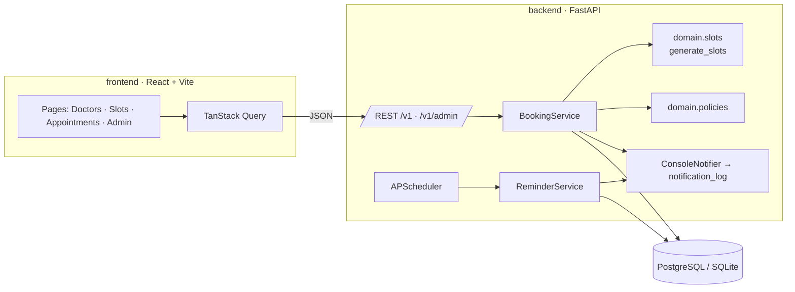

<!-- topics: fastapi,react,typescript,booking-system,healthcare,scheduling,timezone,sqlalchemy,tailwindcss,docker -->
# Appointment Booking System

Doctor-chamber appointment booking for Dhaka: slot generation in Asia/Dhaka, double-booking protection, cancellation and reschedule policies, SMS-style reminders, and a bilingual (EN/BN) React frontend.

[](https://github.com/AkibUllah/appointment-booking-system/actions/workflows/ci.yml)


## Try it live

| | |
|---|---|
| API reference | https://akibullah.github.io/appointment-booking-system/ — Swagger UI rendered from the exported `openapi.json` (static; the Codespace runs the real service) |
| Run in your browser | [](https://codespaces.new/AkibUllah/appointment-booking-system?quickstart=1) — starts Postgres, the API and the frontend with `docker compose` and seeds demo doctors and chambers; open port 8080 for the patient site (admin editor uses the token `dev-admin-token`) and port 8000 for `/docs` |
| One-click deploy | [](https://render.com/deploy?repo=https://github.com/AkibUllah/appointment-booking-system) — backend, frontend and a free Postgres from `render.yaml`; you are asked for `ADMIN_TOKEN` at deploy time |
| Local | `docker compose up --build -d && docker compose run --rm seed` (see Quick Start) |

## Why this exists

Private chambers in Dhaka still run on paper registers and a receptionist's phone. Patients queue for hours because every "appointment" is really a serial number, and doctors change sitting hours week to week. This service models the actual domain: a doctor has weekly sitting windows at a chamber, leave days and extra sittings override them, slots are cut per doctor (10/15/20 minutes), and a booking must never be issued twice for the same slot even when two receptionists click at the same moment. The same core powers the patient site, the admin schedule editor and the reminder job.

## Features

- Weekly availability templates plus date-specific exceptions (whole-day or partial leave, extra sittings)
- Timezone-aware slot generation (Asia/Dhaka) with per-doctor slot length and minimum lead time
- Double-booking protection: availability check in the service layer backed by a unique `slot_key` constraint
- Optimistic locking on bookings (`version` column, mapper `version_id_col`) so stale cancel/reschedule requests get a 409
- Cancellation and reschedule policies (cut-off hours, max reschedules) as pure, tested functions
- OTP-less patient registration keyed on a normalised Bangladeshi mobile number
- Reminders 24h and 1h before the appointment via APScheduler with a console SMS backend and a persisted notification log
- Admin API with token auth: doctor CRUD, schedule editor, exceptions, bookings, stats
- React frontend: doctor search and filters, date strip + slot picker, booking flow, "my appointments" with cancel/reschedule, admin schedule editor, EN/BN toggle with Bangla numerals
- Docker Compose with Postgres, seeded demo data for eight doctors across Dhanmondi, Gulshan, Uttara, Mirpur, Shyamoli and Motijheel

## Architecture



Key decisions:

- **Slots are computed, not stored.** `generate_slots()` is a pure function over templates, exceptions and booked starts, so schedule edits take effect immediately and there is no slot table to keep in sync.
- **Two layers against double booking.** The service re-generates the day's slots and checks availability, then relies on `UNIQUE(slot_key)` (`"<doctor_id>:<utc start>"`, nulled on cancel) to settle any race at the database.
- **Optimistic locking instead of row locks.** Clients send the `version` they last saw; a mismatch returns `409 stale_version`, and SQLAlchemy's `version_id_col` guards concurrent writers.
- **UTC in, local out.** A `UTCDateTime` type decorator stores naive UTC (identical on SQLite and Postgres) and the API emits ISO strings with the `+06:00` offset.
- **Notifications are data.** The console backend writes to `notification_log`, so reminders and confirmations are testable and visible in the admin API without an SMS vendor.

## Tech Stack

| Layer | Choice |
|---|---|
| API | FastAPI 0.115, Pydantic v2, pydantic-settings |
| Persistence | SQLAlchemy 2.0, SQLite (dev/tests), PostgreSQL 16 (compose) |
| Scheduling | APScheduler 3 (interval job, in-process) |
| Frontend | React 18.3, TypeScript 5.4, Vite 5, Tailwind 3.4, TanStack Query 5, React Router 6 |
| Tests | pytest + httpx TestClient · vitest + Testing Library |
| Ops | Docker, docker compose, nginx (static + `/api` proxy), GitHub Actions |

## Quick Start

Docker Compose (Postgres + API + seeded demo data + frontend on http://localhost:8080):

```bash
cp .env.example .env
docker compose up --build -d
docker compose run --rm seed
open http://localhost:8080        # API docs: http://localhost:8000/docs
```

Local development:

```bash
# backend
cd backend
python3 -m venv .venv && .venv/bin/pip install -e ".[dev]"
cp .env.example .env
.venv/bin/python -m app.seed
.venv/bin/uvicorn app.main:app --reload       # http://localhost:8000/docs

# frontend (new terminal)
cd frontend
cp .env.example .env
npm install
npm run dev                                   # http://localhost:5173, proxies /api -> :8000
```

## API

Public (`/v1`):

| Method | Path | Purpose |
|---|---|---|
| GET | `/health` | Liveness |
| GET | `/v1/specialties`, `/v1/chambers` | Reference data |
| GET | `/v1/doctors?q=&specialty_id=&area=&max_fee=` | Search doctors |
| GET | `/v1/doctors/{id}` | Doctor profile |
| GET | `/v1/doctors/{id}/slots?from=YYYY-MM-DD&to=YYYY-MM-DD` | Slots grouped by day (Dhaka local, `available` flag) |
| POST | `/v1/patients` | Register/update patient by phone (idempotent) |
| GET | `/v1/patients/by-phone/{phone}` | Lookup |
| POST | `/v1/bookings` | Book a slot → 201, or 409 `slot_unavailable` |
| GET | `/v1/bookings?phone=` | Patient's bookings |
| POST | `/v1/bookings/{id}/cancel` | `{version, reason}` → 409 `stale_version`, 422 `policy_violation` |
| POST | `/v1/bookings/{id}/reschedule` | `{version, slot_start}` |

Admin (`/v1/admin`, header `X-Admin-Token`):

| Method | Path | Purpose |
|---|---|---|
| POST / PATCH | `/doctors`, `/doctors/{id}` | Create / update doctor |
| GET / PUT | `/doctors/{id}/availability` | Weekly template (PUT replaces) |
| GET / POST / DELETE | `/doctors/{id}/exceptions[/{eid}]` | Leave and extra sittings |
| GET | `/bookings?doctor_id=&status=` | All bookings |
| POST | `/bookings/{id}/complete`, `/bookings/{id}/no-show` | Mark outcome |
| GET | `/stats` | Totals, by status, today, next 7 days, per doctor |
| GET | `/notifications` | Sent messages (console backend) |
| POST | `/reminders/run` | Trigger the reminder job now |

Errors are `{"code": "...", "message": "..."}` with codes `not_found`, `slot_unavailable`, `stale_version`, `policy_violation`, `validation_error`.

## Project Structure

```
appointment-booking-system/
├── backend/
│   ├── app/
│   │   ├── api/            # routers (public, admin), schemas, deps
│   │   ├── core/           # settings, logging, errors, time helpers
│   │   ├── db/             # engine/session, ORM models (UTCDateTime)
│   │   ├── domain/         # pure logic: slots, policies, phone
│   │   ├── services/       # booking, reminders, scheduler, notifier, stats
│   │   ├── main.py         # FastAPI app + lifespan (scheduler)
│   │   └── seed.py         # demo doctors/chambers
│   ├── tests/
│   ├── Dockerfile · Makefile · pyproject.toml
├── frontend/
│   ├── src/
│   │   ├── api/            # typed fetch client
│   │   ├── components/     # SlotPicker, DoctorCard, Toast, Layout
│   │   ├── pages/          # Doctors, Doctor (booking), Appointments, Admin
│   │   ├── i18n/           # EN/BN dictionaries + provider
│   │   └── lib/            # format, phone, slot grouping
│   ├── Dockerfile · nginx.conf.template · vite.config.ts
├── docker-compose.yml
└── .github/workflows/ci.yml
```

## Testing

```bash
cd backend && .venv/bin/python -m pytest      # 51 tests
cd frontend && npm test                        # 25 tests
```

Backend coverage: slot generation (contiguity, +06:00 offset, partial/whole-day leave, extra sittings, lead time, booked flags), phone normalisation, cancel/reschedule policies, booking service (double booking, unique-constraint race, optimistic locking, reschedule limits, reminders sent once per window), and the HTTP API end to end. Frontend: phone and date/time formatting in Dhaka time, slot grouping and date strip, EN/BN dictionary parity, `SlotPicker` and `DoctorCard` rendering and interaction.

## Roadmap

- Replace the console notifier with an SMS gateway adapter (e.g. SSL Wireless) behind the existing `Notifier` protocol
- Alembic migrations instead of `create_all` for schema evolution
- Waiting list: offer a freed slot to the next patient on cancellation
- Per-chamber receptionist accounts instead of a single admin token
- Patient-side OTP verification for phone ownership

## License

MIT © 2026 Akib Jafor
